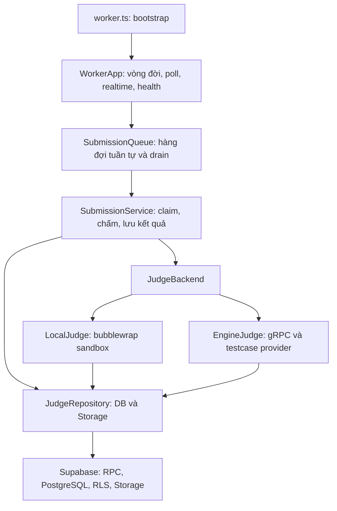

# Kiến trúc backend theo OOP

Backend TypeScript dùng composition và dependency injection qua constructor. Mỗi instance giữ trạng thái riêng; import các lớp không khởi động daemon, đọc `.env` hay đăng ký process signal. `worker.ts` là điểm ghép các dependency và chạy ứng dụng, giữ nguyên lệnh dev/start và đường dẫn `dist/worker.js`.



## Trách nhiệm và vị trí sửa

| Thành phần | File trong `apps/judge-worker/src/` | Trách nhiệm |
|---|---|---|
| Bootstrap | `worker.ts` | Đọc env, chọn backend, ghép object, nhận SIGTERM/SIGINT |
| Cấu hình | `config.ts` | Validate env, trả cấu hình rõ ràng cho từng instance |
| Vòng đời | `worker-app.ts` | Start/stop, subscription, polling, health, heartbeat và dọn tài nguyên cả khi khởi động lỗi |
| Hàng đợi | `submissions/submission-queue.ts` | Một bài tại một thời điểm; gộp sự kiện trùng; dừng nhận mới và chờ bài đang chạy |
| Nghiệp vụ bài nộp | `submissions/submission-service.ts` | Claim nguyên tử trước thực thi; phân nhánh submit/run; chuyển lỗi xử lý thành SYSTEM_ERROR; ghi kết quả |
| Dữ liệu | `data/judge-repository.ts` | Truy vấn bài/testcase, tải Storage, claim/lưu verdict, recover stale, heartbeat, Realtime |
| Contract chấm | `judging/judge-backend.ts` | Contract cho hai implementation thật và kiểu kết quả; hàm thuần tính điểm/chuyển verdict |
| Chấm local | `judging/local-judge.ts` | Compile và chạy qua SandboxEngine; dùng chung vòng đời thư mục tạm cho submit/run |
| Chấm engine | `judging/engine-judge.ts` | Quản lý client/provider, registry UUID→int, đọc stream kết quả và SelfTest |

Không dùng base class, service locator, DI framework hoặc repository generic. Các class hiện có `SandboxEngine`, `RsjudgeEngineClient`, `CasesProviderServer` tiếp tục được dùng. So sánh output và tính điểm giữ dạng hàm thuần.

## Mở rộng và bảo trì

- Thay truy vấn/persistence trong `JudgeRepository`; lỗi claim/lưu kết quả phải được truyền lên worker để dừng tiêu thụ bài.
- Thay quy trình xử lý submit/run trong `SubmissionService`. Không bỏ claim, không đổi `is_run` và không đưa output hidden vào kết quả trả người dùng.
- Thay compiler/isolation trong `SandboxEngine`; `LocalJudge` quản lý trình tự và tài nguyên mỗi bài.
- Nếu thực sự cần backend chấm khác, implement `JudgeBackend` (`initialize`, `isReady`, `judge`, `run`, `close`, `mode`) rồi chọn tại bootstrap. Contract `mode` hiện chỉ gồm `local`/`engine`; một mode mới cần cập nhật đồng bộ constraint `judge_servers.mode` và health/monitoring.
- Quy tắc quyền, quota và toàn vẹn dữ liệu vẫn được thực thi bằng SQL/RPC/RLS trong Supabase. OOP không thay thế lớp bảo vệ DB. API trong `apps/web/src/lib/api/` là adapter phía trình duyệt, không chứa service-role key.
- Mỗi DB vẫn chỉ chạy một daemon. Các object không có shared mutable state không đồng nghĩa với hỗ trợ vận hành nhiều worker trên cùng DB.

## Kiểm chứng

```bash
npm --prefix apps/judge-worker test
npm --prefix apps/judge-worker run smoke
npm run test:pilot
```

Unit/lifecycle tests dùng dependency giả và HTTP health thật để kiểm tra claim, hàng đợi trùng/tuần tự, drain, lỗi xử lý/lưu kết quả và cleanup. Pilot dùng PostgreSQL/PostgREST tạm, thực thi code trong sandbox thật với cả local và Rust engine; không kết nối DB staging. CI đã thêm lệnh unit test; cần chạy GitHub workflow để xác nhận trên CI.
